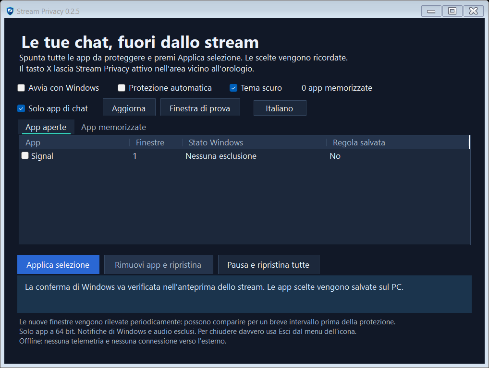

# Stream Privacy

**Le finestre che scegli restano sul tuo monitor, fuori dalle condivisioni compatibili.**

`Windows x64` · `Offline` · `Nessuna telemetria` · `Tema scuro` · [Licenza MIT](LICENSE)

[English](README.md) · **Italiano** · [Download](https://github.com/flavio92fs/StreamPrivacy/releases) · [Privacy](PRIVACY.md)

Stream Privacy è una piccola utilità per Windows che richiede l'esclusione dalla cattura delle app scelte. Le finestre restano utilizzabili sul tuo monitor, mentre i metodi di registrazione e condivisione compatibili le omettono. Puoi selezionare più app con le caselle di spunta, ricordare le scelte e lasciare il programma attivo vicino all'orologio.

**La compatibilità dipende dall'app, da Windows e dal metodo di cattura. Comparire nell'elenco significa essere stata rilevata: non certifica che l'esclusione sia supportata o verificata. Stream Privacy non può promettere di nascondere tutte le app.**

> **Nessuna telemetria, nessuna analisi di utilizzo, nessun account e nessuna connessione di rete in uscita.** Stream Privacy non invia informazioni agli sviluppatori o a servizi esterni. Le impostazioni restano sul tuo computer. Leggi i [dettagli sulla privacy](PRIVACY.md), compresi i metadati locali necessari a identificare le finestre.



*Schermata dell'interfaccia v0.2.5 con un'app dimostrativa: comparire qui non certifica la compatibilità con la cattura.*

## Download

Scarica i pacchetti v0.2.6 da [GitHub Releases](https://github.com/flavio92fs/StreamPrivacy/releases):

| Pacchetto | Utilizzo | Impostazioni |
| --- | --- | --- |
| [ZIP portable](https://github.com/flavio92fs/StreamPrivacy/releases/download/v0.2.6/StreamPrivacy-0.2.6-win-x64-portable.zip) | Estrai e avvia senza installazione | `Data/settings.xml` accanto all'eseguibile |
| [Installer per utente](https://github.com/flavio92fs/StreamPrivacy/releases/download/v0.2.6/StreamPrivacy-0.2.6-win-x64-setup.exe) | Installazione e collegamenti | `%LOCALAPPDATA%\StreamPrivacy\settings.xml` |

Entrambi i pacchetti funzionano offline. L'installer non richiede privilegi di amministratore e non scarica componenti né cerca aggiornamenti. Servono Windows x64 e .NET Framework 4.8; l'esclusione completa richiede Windows 10 versione 2004 o successiva. L'interfaccia del programma è disponibile **in italiano e in inglese**.

Nella versione portable mantieni eseguibile, `PrivacyHook64.dll` e `portable.flag` nella stessa cartella scrivibile. La versione installata non richiede il file marcatore.

Gli eseguibili attuali **non sono firmati digitalmente**. La release include un file **SHA256SUMS** per controllare l'integrità dei download: gli hash non costituiscono una firma digitale o una garanzia di compatibilità.

## Scegli cosa proteggere

1. Apri le app da escludere, poi avvia Stream Privacy.
2. Spunta le loro righe in **App aperte**. Ogni riga rappresenta un eseguibile, comprese le finestre rilevate che gli appartengono.
3. Premi **Applica selezione**. Le app spuntate vengono ricordate; togliendo la spunta a un'app aperta e applicando, rimuovi la regola e ripristini le modifiche di questa sessione.
4. Lascia attiva **Protezione automatica** per applicare le regole salvate quando le app si riaprono o creano nuove finestre.
5. Se vuoi, attiva **Avvia con Windows**: al prossimo accesso al tuo account il programma partirà vicino all'orologio.

I nuovi profili mostrano **tutte le app rilevate** per impostazione predefinita. **Solo app di chat** è un filtro facoltativo che comprende WhatsApp, Telegram, Discord, Signal e altre chat riconosciute. Togli la spunta per vedere anche app sconosciute o di altro tipo. I profili esistenti conservano la precedente preferenza del filtro. Il riconoscimento non è un elenco di app collaudate e non certifica la compatibilità.

L'interfaccia parte con il **tema scuro**. Usa **Tema scuro** per cambiare aspetto e scegli **English** o **Italiano** dal selettore della lingua: entrambe le preferenze vengono salvate localmente. Puoi anche avviare `StreamPrivacy.exe --language it` oppure `StreamPrivacy.exe --language en`.

Il tasto **X** e la minimizzazione lasciano il programma attivo. Per riaprirlo fai doppio clic sullo scudo vicino all'orologio. Il suo menu offre **Ripristina finestra**, **Pausa e ripristina tutte** ed **Esci e ripristina**. Disattivare soltanto la protezione automatica ferma le nuove richieste, senza annullare le esclusioni già applicate. Le regole delle app chiuse restano in **App memorizzate**.

## Verifica prima di condividere

Premi **Finestra di prova**. La prova non contiene dati personali, si protegge automaticamente e mostra se Windows conferma l'esclusione. **Sul tuo monitor deve restare visibile.** Controlla una registrazione OBS oppure il video effettivamente ricevuto da un'altra persona su Discord.

“Esclusione confermata” indica che Windows restituisce l'impostazione richiesta. **Non** certifica l'uscita di ogni programma di registrazione. [OBS offre diversi metodi di cattura](https://obsproject.com/kb/window-capture-sources) e [anche Discord utilizza più tecnologie](https://support.discord.com/hc/en-us/articles/9410427556375--Windows-Capturing-Application-Window-for-Screen-Share-and-Go-Live). Ripeti la verifica se cambi sorgente o metodo di cattura.

## Come funziona

Windows offre [`SetWindowDisplayAffinity`](https://learn.microsoft.com/en-us/windows/win32/api/winuser/nf-winuser-setwindowdisplayaffinity) con `WDA_EXCLUDEFROMCAPTURE`, applicabile a una finestra del processo che la richiama. Per un'altra app, Stream Privacy carica temporaneamente il suo modulo x64 tramite un [hook `SetWindowsHookEx` sul singolo thread](https://learn.microsoft.com/en-us/windows/win32/api/winuser/nf-winuser-setwindowshookexw), richiede l'impostazione dentro quel processo, ne verifica il valore e rimuove l'hook.

Non installa driver o servizi e non riscrive i file installati delle altre app. Prima di modificare una finestra, salva l'impostazione originaria in un registro locale di recupero e avvia un processo separato dallo stesso eseguibile.

## Recupero dopo una chiusura imprevista

Se il processo principale va in crash o viene terminato, il processo di recupero tenta di ripristinare le finestre modificate durante quella sessione. Il registro identifica quelle finestre: il recupero non rimuove indiscriminatamente le protezioni di tutte le app. Le protezioni già presenti prima dell'intervento di Stream Privacy vengono conservate.

Se viene terminato anche il processo di recupero, all'avvio successivo il programma controlla i registri abbandonati prima di applicare nuove protezioni. I registri si trovano in `Data/Recovery` nella versione portable oppure in `%LOCALAPPDATA%\StreamPrivacy\Recovery` nella versione installata. Contengono identificativi locali di finestre/processi e impostazioni originarie, non il contenuto delle finestre: dettagli in [Privacy](PRIVACY.md).

**Interrompi o metti in pausa lo stream prima di uscire o ripristinare le protezioni.** Le finestre ripristinate possono tornare visibili in una registrazione o condivisione ancora attiva. Lascia disattivata **Protezione automatica** se vuoi che le app interessate restino catturabili dopo averle riaperte.

Un'app bloccata o non accessibile può impedire il ripristino. Esci completamente da quell'app, compreso il processo vicino all'orologio, e riaprila con Stream Privacy in pausa o chiuso. Questa è anche la procedura per le esclusioni rimaste dalla v0.2.5 o da versioni precedenti: quelle versioni non salvavano il registro necessario al recupero automatico.

## Limiti pratici

- **Una nuova finestra può comparire brevemente.** Il rilevamento avviene circa ogni 750 ms quando non ci sono operazioni in corso. App lente, composizione e richieste fallite possono allungare l'intervallo; i tentativi non riusciti vengono ripetuti dopo circa 15 secondi. Non è una garanzia di assenza di fotogrammi visibili.
- Sono supportate soltanto **app x64 compatibili**. App elevate, processi protetti e alcune app Store possono rifiutare il modulo.
- Le regole usano il percorso completo dell'eseguibile. Se un aggiornamento cambia cartella, seleziona nuovamente l'app.
- Notifiche di Windows, audio, finestre gestite da un altro eseguibile e metodi di cattura incompatibili non sono coperti.
- Il recupero richiede che il processo separato resti attivo oppure che Stream Privacy venga avviato nuovamente. Se entrambi i processi vengono terminati, le finestre possono restare escluse fino all'avvio successivo o al riavvio completo delle app interessate.
- [Microsoft non garantisce la sicurezza dei contenuti tramite questa funzione](https://learn.microsoft.com/en-us/windows/win32/api/winuser/nf-winuser-setwindowdisplayaffinity). Il programma riduce il rischio di esposizioni accidentali: verifica sempre il video condiviso.

## Compilazione e verifiche

Servono Visual Studio Build Tools con strumenti C++ x64, Windows SDK e il compilatore .NET Framework. Dalla cartella del repository:

```powershell
.\src\build.ps1
```

I file compilati si trovano in `src\bin`. Le verifiche di sviluppo usano finestre dimostrative e scrivono rapporti locali soltanto se avviate esplicitamente:

```powershell
.\src\bin\StreamPrivacy.exe --self-test core.txt
.\src\bin\StreamPrivacy.exe --integration-test integration.txt
.\src\bin\StreamPrivacy.exe --regression-test selection.txt
.\src\bin\StreamPrivacy.exe --capture-demo-test demo.txt
.\src\bin\StreamPrivacy.exe --tray-restore-test tray.txt
.\src\bin\StreamPrivacy.exe --forced-exit-test forced-exit.txt
```

Coprono esclusione e ripristino nativi, regole salvate, selezione multipla, aggiornamento stabile, recupero dall'area icone e recupero dopo una terminazione forzata. Il rendering dell'interfaccia o un test dimostrativo superato non provano che Discord o OBS omettano ogni app: verifica il video effettivamente condiviso. Codice e icona originale sono distribuiti con [licenza MIT](LICENSE).

Per generare il portable ZIP e l'installer offline, scarica il compilatore portable dalla [distribuzione ufficiale NSIS](https://sourceforge.net/projects/nsis/files/NSIS%203/3.13/) ed esegui:

```powershell
.\scripts\package.ps1 -NsisPath 'C:\Tools\nsis-3.13\makensis.exe' -BuildTestInstaller
.\scripts\test.ps1
.\scripts\test-installer.ps1 -TestSetupPath .\build\StreamPrivacy-installer-test.exe
```

I file della release vengono scritti in `dist/<versione>`. La prova isolata dell'installer evita registrazioni e collegamenti di sistema reali. Gli strumenti di compilazione si scaricano separatamente: programma e installer distribuiti non li scaricano mai. I componenti NSIS dell'installer mantengono le proprie [licenze di terze parti](THIRD_PARTY_NOTICES.txt).
