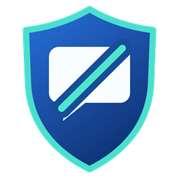
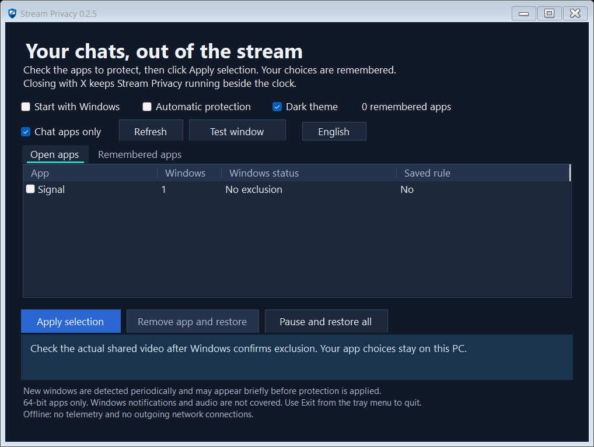

# Stream Privacy

**Keep selected windows on your screen and out of compatible screen shares.**

`Windows x64` · `Offline` · `No telemetry` · `Dark theme` · [MIT license](LICENSE)

**English** · [Italiano](README.it.md) · [Downloads](https://github.com/flavio92fs/StreamPrivacy/releases) · [Privacy](PRIVACY.md)

Stream Privacy is a small Windows utility that requests capture exclusion for the apps you choose. Your windows remain usable on your monitor while compatible recording and screen-sharing methods omit them. Select several apps with checkboxes, remember your choices, and leave the utility running beside the clock.

**Compatibility depends on the target app, Windows and the capture method. An app appearing in the list means it was detected, not that exclusion is supported or has been verified. Stream Privacy cannot promise to hide every app.**

> **No telemetry, no analytics, no accounts, and no outgoing network connections.** Stream Privacy does not send information to its developers or to external services. Its settings stay on your computer. See the [privacy details](PRIVACY.md), including the local metadata it needs to identify windows.



*The screenshot uses a demonstration app; appearing here does not certify capture compatibility.*

## Download

Get the v0.2.5 packages from [GitHub Releases](https://github.com/flavio92fs/StreamPrivacy/releases):

| Package | Best for | Settings |
| --- | --- | --- |
| [Portable ZIP](https://github.com/flavio92fs/StreamPrivacy/releases/download/v0.2.5/StreamPrivacy-0.2.5-win-x64-portable.zip) | Extract and run without installation | `Data/settings.xml` beside the executable |
| [Per-user installer](https://github.com/flavio92fs/StreamPrivacy/releases/download/v0.2.5/StreamPrivacy-0.2.5-win-x64-setup.exe) | Installation and shortcuts | `%LOCALAPPDATA%\StreamPrivacy\settings.xml` |

Both packages work offline. The installer does not require administrator privileges and does not download runtimes or check for updates. Windows x64 and .NET Framework 4.8 are required; complete exclusion requires Windows 10 version 2004 or later. The application interface is available in **English and Italian**.

Keep the portable executable, `PrivacyHook64.dll`, and `portable.flag` together in a writable folder. The installed version does not need that marker.

The current binaries are **unsigned**. The release includes a **SHA256SUMS** checksum file for checking downloaded-file integrity; checksums are not a digital signature or a compatibility guarantee.

## Choose what stays private

1. Open the apps you want to exclude, then start Stream Privacy.
2. Check their rows in **Open apps**. One row represents one executable, including its detected windows.
3. Click **Apply selection**. Checked apps are remembered; unchecking an open app and applying removes its rule and restores this session's changes.
4. Leave **Automatic protection** enabled to apply saved rules when apps reopen or create new windows.
5. Optionally enable **Start with Windows**. It starts in the notification area at your next Windows sign-in.

New profiles show **all detected apps** by default. **Chat apps only** is an optional convenience filter covering WhatsApp, Telegram, Discord, Signal and other recognized chat apps. Uncheck it to see unknown or other apps. Existing profiles retain their previous filter preference. Recognition is not a tested-app list or a compatibility guarantee.

The interface starts with a **dark theme**. Toggle **Dark theme** to switch appearance. Choose **English** or **Italiano** in the language selector; both theme and language are saved locally. You can also start with `StreamPrivacy.exe --language en` or `StreamPrivacy.exe --language it`.

Closing with **X** or minimizing keeps the utility running. Double-click the shield beside the clock to reopen it. Its menu offers **Recover window**, **Pause and restore all**, and **Exit and restore**. Simply disabling automatic protection stops future requests; it does not undo already applied exclusions. Saved rules for closed apps remain under **Remembered apps**.

## Test before sharing

Click **Test window**. The harmless test protects itself automatically and reports whether Windows confirms exclusion. **It should remain visible on your own monitor.** Check an OBS recording or the video actually received by someone on Discord.

“Exclusion confirmed” means Windows reports the requested setting. It does **not** certify the output of every recorder. [OBS exposes different capture methods](https://obsproject.com/kb/window-capture-sources), and [Discord also uses multiple capture technologies](https://support.discord.com/hc/en-us/articles/9410427556375--Windows-Capturing-Application-Window-for-Screen-Share-and-Go-Live). Recheck after changing your capture source or method.

## How it works

Windows provides [`SetWindowDisplayAffinity`](https://learn.microsoft.com/en-us/windows/win32/api/winuser/nf-winuser-setwindowdisplayaffinity) with `WDA_EXCLUDEFROMCAPTURE`. It applies to a window owned by the calling process. For another app, Stream Privacy temporarily loads its x64 helper through a thread-specific [`SetWindowsHookEx` hook](https://learn.microsoft.com/en-us/windows/win32/api/winuser/nf-winuser-setwindowshookexw), requests the setting inside that process, reads it back, and removes the hook.

It installs no driver or service and does not rewrite other apps' installed files. The original setting is retained for restoration of this session's changes.

## Practical limits

- **New windows can briefly appear.** Detection runs about every 750 ms when idle. Slow apps, composition and failed requests can extend the interval; failed requests are retried after about 15 seconds. This is not a guarantee of zero leaked frames.
- Only supported **x64 apps** are targeted. Elevated, protected or some Store apps may reject the helper.
- Rules match the full executable path. Reselect an app if an update moves it to a new folder.
- Windows notifications, audio, windows belonging to another executable, and incompatible capture methods are not covered.
- A crash or forced termination can leave a window excluded. Close and reopen the affected app to reset it.
- [Microsoft does not guarantee content security through display affinity](https://learn.microsoft.com/en-us/windows/win32/api/winuser/nf-winuser-setwindowdisplayaffinity). Use the tool to reduce accidental exposure and verify the actual shared output.

## Build and checks

Install Visual Studio Build Tools with C++ x64 tools, a Windows SDK, and the .NET Framework compiler. From the repository root:

```powershell
.\src\build.ps1
```

The output is in `src\bin`. Development checks use harmless demo windows and write local reports when explicitly requested:

```powershell
.\src\bin\StreamPrivacy.exe --self-test core.txt
.\src\bin\StreamPrivacy.exe --integration-test integration.txt
.\src\bin\StreamPrivacy.exe --regression-test selection.txt
.\src\bin\StreamPrivacy.exe --capture-demo-test demo.txt
.\src\bin\StreamPrivacy.exe --tray-restore-test tray.txt
```

These checks cover native exclusion/restoration, saved rules, multiple selections, stable refresh, and tray recovery. Rendering an interface or passing a demo test does not prove that Discord or OBS will omit every app. Test the actual shared video. Code and the original icon are released under the [MIT license](LICENSE).

To build the portable ZIP and offline installer, obtain the portable compiler from the [official NSIS distribution](https://sourceforge.net/projects/nsis/files/NSIS%203/3.13/) and run:

```powershell
.\scripts\package.ps1 -NsisPath 'C:\Tools\nsis-3.13\makensis.exe' -BuildTestInstaller
.\scripts\test.ps1
.\scripts\test-installer.ps1 -TestSetupPath .\build\StreamPrivacy-installer-test.exe
```

Release files are written to `dist`. The isolated installer test avoids real registration and system shortcuts. Build tools are obtained separately; the delivered app and installer never download them. NSIS installer components have their own [third-party notices](THIRD_PARTY_NOTICES.txt).
